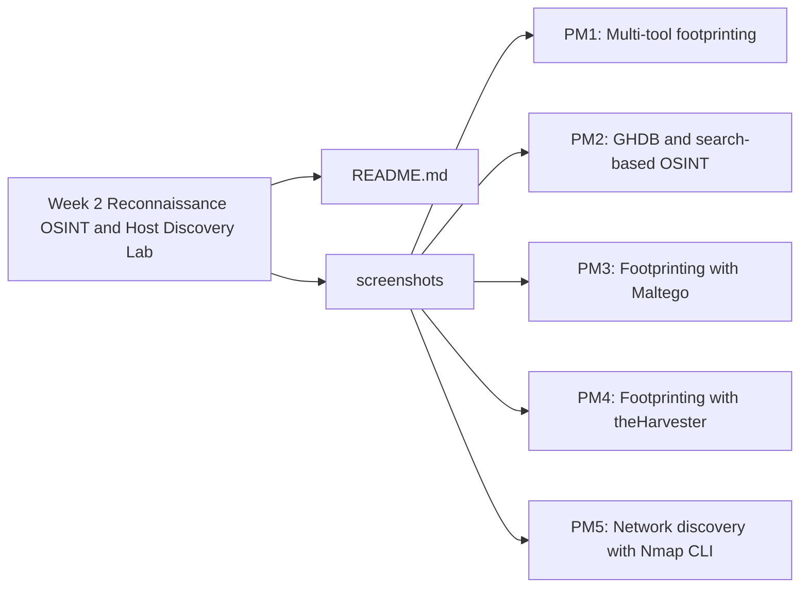

<div align="center">

# 🔍 Week 2: Reconnaissance, OSINT & Host Discovery Lab

### Authorized footprinting and network discovery labs from the Networkwalks Cybersecurity Internship

**by Mulenga Chiwele** · Batch BO83 · 13 November 2026


[Overview](#overview) · [Modules](#modules-summary) · [Cheat Sheet](#command-cheat-sheet) · [Skills](#skills-demonstrated) · [Risk Summary](#risk-summary) · [Contact](#about-the-author)

</div>

---

## Table of Contents

- [Overview](#overview)
- [Objectives](#objectives)
- [Lab Environment](#lab-environment)
- [Modules Summary](#modules-summary)
- [Module Write-ups](#module-write-ups)
- [Command Cheat Sheet](#command-cheat-sheet)
- [Skills Demonstrated](#skills-demonstrated)
- [Methodology](#methodology)
- [Risk Summary](#risk-summary)
- [Defensive Recommendations](#defensive-recommendations)
- [Key Takeaways](#key-takeaways)
- [Repository Structure](#repository-structure)
- [Project Report](#project-report)
- [About the Author](#about-the-author)
- [Disclaimer](#disclaimer)

---

## Overview

This repository documents my Week 2 work in the [Networkwalks](https://networkwalks.com) Cybersecurity Internship. The labs covered authorized reconnaissance, footprinting, open-source intelligence (OSINT) and local-network host discovery. For each exercise I gathered public information, verified it, documented what it showed, and stopped where authorization ended.

**Ethics statement:** Testing was limited to the explicitly authorized `networkwalks.com` target and a private virtual LAN. No exploitation, password testing, authentication bypass or destructive activity was performed. Public indexing was never treated as authorization.

## Objectives

- Learn how an organization's public footprint is revealed through DNS, web and search data.
- Practice fingerprinting web technologies and identifying web application firewalls (WAFs).
- Map relationships between a domain and public email addresses.
- Use passive OSINT tools, and understand why their results change over time.
- Reproduce host discovery from the command line on a private network.
- Report findings with clear scope, responsible evidence handling and honest risk ratings.

## Lab Environment

| Item | Details |
|------|---------|
| Operating system | Kali Linux |
| Primary tools | WHOIS, WhatWeb, nslookup, curl, Wafw00f, DNSRecon, Maltego, theHarvester, Nmap |
| Authorized target | `networkwalks.com` |
| Public-data target | `microsoft.com` (theHarvester, as specified in the assignment) |
| Private test network | Personal virtual LAN (addresses omitted) |
| Project date | 13 November 2026 |

## Modules Summary

| # | Module | Category | Outcome |
|:-:|--------|----------|---------|
| PM1 | [Multi-tool footprinting](#pm1-multi-tool-footprinting) | Domain, DNS and web reconnaissance | Technology stack, DNS records and WAF identified |
| PM2 | [GHDB and search-based OSINT](#pm2-ghdb-and-search-based-osint) | Search-engine methodology | Educational file listings observed; exposed camera interface pattern recognized |
| PM3 | [Maltego footprinting](#pm3-footprinting-with-maltego) | Entity and relationship mapping | One unique public organizational address mapped |
| PM4 | [theHarvester footprinting](#pm4-footprinting-with-theharvester) | Passive public-source collection | Aggregate results collected; source limitations documented |
| PM5 | [Nmap host discovery](#pm5-network-discovery-with-nmap-cli) | Local host discovery | 2 live hosts found on the virtual LAN |

---

## Module Write-ups

### PM1: Multi-Tool Footprinting

**Category:** Domain, DNS and web reconnaissance

**Scenario:** Build a picture of `networkwalks.com`'s public footprint using several small, read-only tools.

**Approach:**

1. Checked registration data with WHOIS.
2. Fingerprinted the web stack with WhatWeb.
3. Resolved the domain with nslookup.
4. Inspected HTTP response headers with curl.
5. Identified the web application firewall with Wafw00f.
6. Enumerated DNS records with DNSRecon.

**Findings:**

| Tool | Command | Key Observation |
|------|---------|-----------------|
| WHOIS | `whois networkwalks.com` | Registrar, privacy-protected registration and hosting nameservers identified |
| WhatWeb | `whatweb networkwalks.com` | Apache, WordPress 7.1.1, WP Download Manager 3.3.58 and other technologies detected |
| Nslookup | `nslookup networkwalks.com` | Domain resolved to a single public IP address |
| curl | `curl -I https://networkwalks.com` | HTTP/2 200; Apache and WordPress REST API links visible in headers |
| Wafw00f | `wafw00f networkwalks.com` | ModSecurity (SpiderLabs) WAF identified |
| DNSRecon | `dnsrecon -d networkwalks.com` | SOA, NS, MX, A, TXT/SPF and SRV records enumerated |

**What I learned:** No single tool shows the whole picture. Each one reveals a different layer, and together they show how much a public website discloses about itself. These are reconnaissance observations, not proof of exploitable vulnerabilities.

---

### PM2: GHDB and Search-Based OSINT

**Category:** Search-engine methodology

**Scenario:** Use search operators (Google Hacking Database style queries) to see what a search engine indexes, while staying inside ethical limits.

**Approach:**

1. Ran an educational file-type query:

   ```
   filetype:pdf mathematics site:edu
   ```

2. Ran the assignment-provided camera query:

   ```
   intitle:"webcamXP" inurl:8080
   ```

3. Stopped validation at the search results and recorded the methodology, with sensitive details redacted.

**Findings:**

- Ten educational PDF listings came from institutional domains such as Carnegie Mellon, Stanford, UC Davis and MIT OpenCourseWare. Files were not redistributed.
- The camera query showed that search engines can index exposed camera-management interfaces.

**What I learned:** Being indexed is not the same as being authorized. Searching for a system is not the same as having permission to check it, so I stopped at the search results.

*Safe alternative for future testing:* instructor-controlled cameras, honeypots or devices covered by written authorization.

---

### PM3: Footprinting with Maltego

**Category:** Entity and relationship mapping

**Scenario:** Map the relationship between `networkwalks.com` and public email addresses.

**Approach:**

1. Created a Domain entity for `networkwalks.com`.
2. Ran two public-data transforms against it:
   - To Email Addresses [Search Engine]
   - To Emails @domain [Search Engine]

**Findings:**

- Both transforms returned one unique organizational address, `info@networkwalks.com`.
- The second transform added no new unique address.

**What I learned:** Search-engine results can be incomplete or outdated, so every automated finding needs manual verification before it is treated as fact.

---

### PM4: Footprinting with theHarvester

**Category:** Passive public-source collection

**Scenario:** Collect public domain intelligence for `microsoft.com` using theHarvester 4.11.1.

**Approach:**

1. **Task 1:** Ran a single source (Baidu) with a limit of 1000.
2. **Task 2:** Ran all sources with a limit of 50.
3. Recorded which sources needed API keys or returned errors.

**Findings:**

- The Baidu-only run returned no IPs, emails, people or hosts.
- The all-sources run returned aggregate results from the sources that responded:
  - 9 ASNs
  - 134 IP addresses
  - 3 email addresses
  - 9,964 hosts/subdomains
  - 1 interesting URL
- The full host inventory is intentionally excluded from this repository.

**What I learned:** Third-party sources and parsers change over time, so a source that worked before may return nothing today. Results should always be reported with their limitations.

---

### PM5: Network Discovery with Nmap CLI

**Category:** Local host discovery

**Scenario:** Reproduce the required Zenmap ping scan using only the command line, on my own virtual LAN.

**Approach:**

1. Confirmed the local interface, address and gateway.
2. Ran a host-discovery-only sweep:

   ```bash
   sudo nmap -sn <virtual-lan-subnet>
   ```

**Findings:**

- 2 live hosts were discovered.
- No port, service-version or vulnerability scanning was performed.

**What I learned:** Nmap's command line produces the same host-discovery results as Zenmap. The `-sn` flag keeps the scan limited to finding live hosts.

---

## Command Cheat Sheet

| Purpose | Command |
|---------|---------|
| Registration lookup | `whois networkwalks.com` |
| Web technology fingerprint | `whatweb networkwalks.com` |
| Domain resolution | `nslookup networkwalks.com` |
| HTTP response headers | `curl -I https://networkwalks.com` |
| WAF detection | `wafw00f networkwalks.com` |
| DNS enumeration | `dnsrecon -d networkwalks.com` |
| Passive collection (single source) | `theHarvester -d microsoft.com -l 1000 -b baidu` |
| Passive collection (all sources) | `theHarvester -d microsoft.com -l 50 -b all` |
| Local host discovery | `sudo nmap -sn <virtual-lan-subnet>` |
| Search-engine file query | `filetype:pdf mathematics site:edu` |

## Skills Demonstrated

| Area | Details |
|------|---------|
| **Passive reconnaissance** | Gathering public registration, DNS and web-stack data without touching systems beyond normal requests |
| **Web fingerprinting** | Identifying CMS, plugins, server software and WAF technology |
| **DNS analysis** | Reading SOA, NS, MX, A, TXT/SPF and SRV records |
| **OSINT** | Search-operator methodology and passive collection with theHarvester |
| **Relationship mapping** | Building entities and transforms in Maltego |
| **Network discovery** | Host discovery with Nmap CLI on a private network |
| **Evidence handling** | Redacting device addresses and excluding raw, sensitive output |
| **Ethical scoping** | Recognizing where authorization ends and stopping there |

## Methodology

1. **Define scope** and confirm written authorization before any activity.
2. **Gather** public information with passive tools first.
3. **Verify** each automated result before treating it as a finding.
4. **Document** the command, the observation and its limitations.
5. **Redact** sensitive data before publishing any evidence.
6. **Rate** each observation honestly, and avoid calling it a vulnerability without proof.

## Risk Summary

These ratings are educational assessments. No finding was exploited or confirmed as a vulnerability.

| Observation | Potential Impact | Level |
|-------------|------------------|-------|
| Public CMS and plugin fingerprints | May help prioritize targeted research | Medium |
| Public server IP and DNS information | Supports infrastructure mapping | Low |
| HTTP headers and REST API links | Supports application fingerprinting | Low |
| Identifiable WAF | Reveals part of the defensive architecture | Low |
| Large public subdomain inventory | Increases asset-management complexity | Medium |
| Internet-indexed camera interfaces | Serious privacy and physical-security exposure | High |
| Hosts visible on a local network | Unknown devices may need investigation | Low |

## Defensive Recommendations

| Finding | Recommended Control |
|---------|---------------------|
| CMS and plugin fingerprints | Keep platforms, plugins and server components patched; remove unneeded version disclosure |
| Public DNS and certificate-derived assets | Review regularly and maintain an accurate external asset inventory |
| WAF visibility | Keep the WAF updated, tuned and monitored |
| Internet-indexed cameras | Place behind authentication, network segmentation and VPN access |
| Unknown local devices | Run authorized internal discovery periodically and investigate unrecognized hosts |
| Sensitive evidence | Redact before publishing; obtain written authorization before every assessment |

## Key Takeaways

- Each reconnaissance tool reveals a different part of an organization's public footprint.
- Results change as data providers and APIs evolve, so findings need re-verification.
- Nmap CLI can reproduce Zenmap's host-discovery functionality.
- An observation is a lead, not a confirmed vulnerability.
- Being discoverable or reachable does not mean you are authorized to test.
- Clear scope and responsible evidence handling are core cybersecurity skills.

## Repository Structure

The repository contains this `README.md` with all the module write-ups, and a `screenshots` folder with the evidence for each module:

- **PM1:** Multi-tool footprinting
- **PM2:** GHDB and search-based OSINT
- **PM3:** Footprinting with Maltego
- **PM4:** Footprinting with theHarvester
- **PM5:** Network discovery with Nmap CLI



## Project Report

📄 **[Download the Week 2 Project Report](./Week2-Project-Report.pdf)**

## About the Author

**Mulenga Chiwele**
Aspiring Security Analyst | Network Security

I am building hands-on skills in reconnaissance, OSINT and network analysis, with an emphasis on ethical scope and clear documentation.

- GitHub: [mulengachiwele174-afk](https://github.com/mulengachiwele174-afk)
- LinkedIn: [Mulenga Chiwele](https://www.linkedin.com/in/mulenga-chiwele-712a64365)
- Email: [Mulengachiwele174@gmail.com](mailto:Mulengachiwele174@gmail.com)

## Disclaimer

All exercises were completed for educational purposes within an authorized scope, in a personal lab and the authorized Networkwalks environment. No exploitation, password testing, authentication bypass or destructive activity was performed. Raw outputs, live-camera imagery, working device addresses and other unnecessary sensitive evidence have been excluded. This repository does not authorize testing of any system it mentions.

---

<div align="center">

### © 2026 Mulenga Chiwele · All Rights Reserved

This write-up is the original work of **Mulenga Chiwele**. You are welcome to read and link to it. Please do not copy or republish it as your own without permission.

<sub>Week 2 Reconnaissance, OSINT & Host Discovery Lab · 13 November 2026</sub>

<sub>Enquiries: [Mulengachiwele174@gmail.com](mailto:Mulengachiwele174@gmail.com)</sub>

</div>
